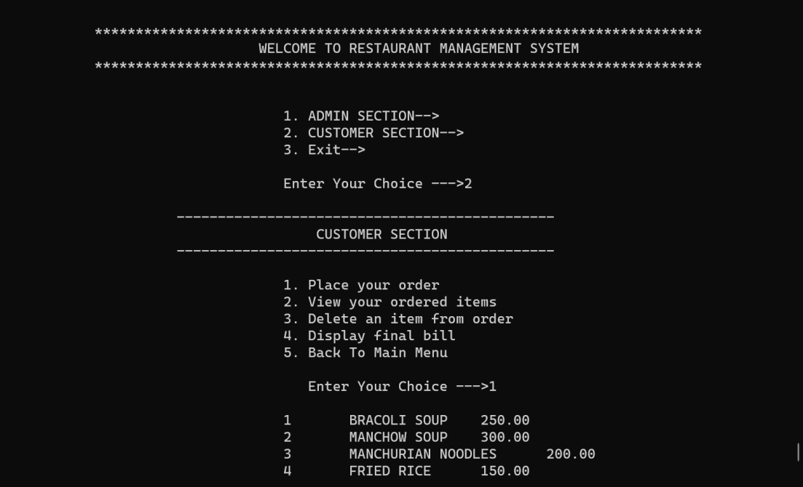
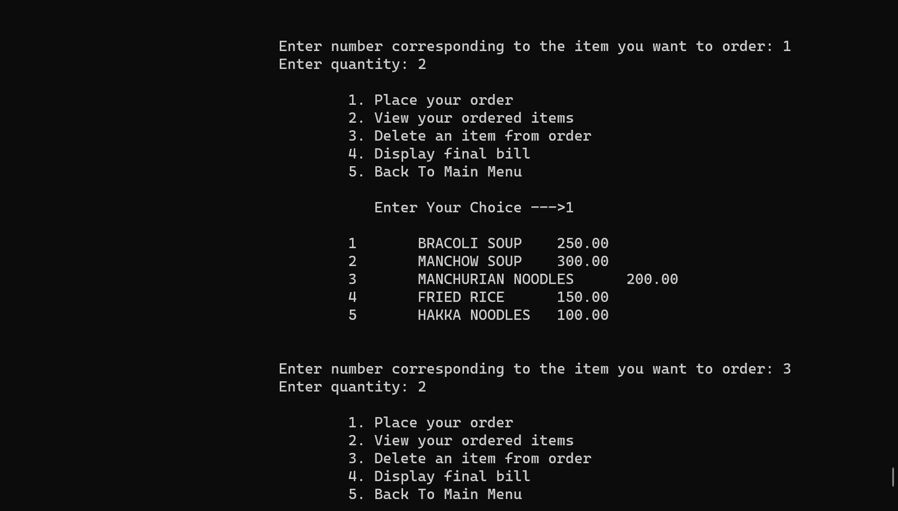
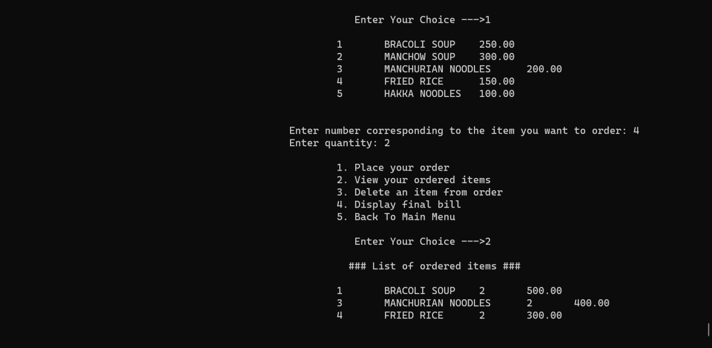
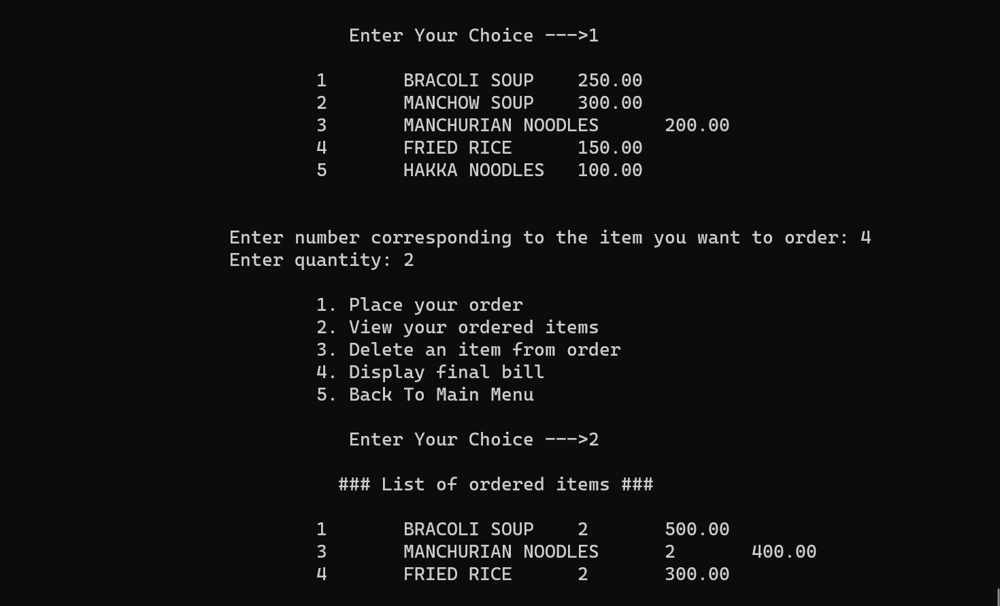
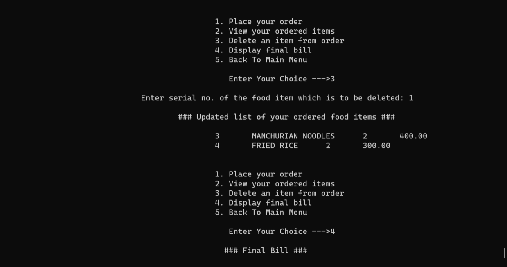
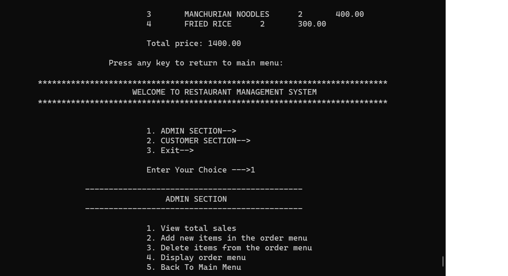

# Restaurant Billing Management System

A CLI-based Point of Sale (POS) and inventory management application built in C using singly linked list data structures.

## Features

- **Admin Module**:
  - View overall sales history and cumulative revenue
  - Dynamically add new food items and pricing to the catalog
  - Delete items from the menu
  - View the active restaurant catalog

- **Customer Module**:
  - Browse menu offerings
  - Place custom orders with variable quantities
  - View active cart/order summary
  - Remove items from cart
  - Automated bill generation with subtotal calculation

## Data Structures & Implementation

- **Singly Linked Lists**: Handles dynamic catalog expansion, individual customer carts, and sales tracking without fixed array limitations.
- **Dynamic Memory Allocation**: Employs `malloc` and `free` to allocate nodes during order sessions and release heap memory after checkout.

## Getting Started

### Prerequisites
- GCC / Clang compiler
- Any Terminal / Command Prompt

### Build and Run

1. Clone the repository:
   ```bash
   git clone [https://github.com/](https://github.com/)<your-username>/restaurant-billing-management-system.git
   cd restaurant-billing-management-system

## Demo / Screenshots

### Customer Order & Billing


### Bill Calculation


### Admin Menu Management





